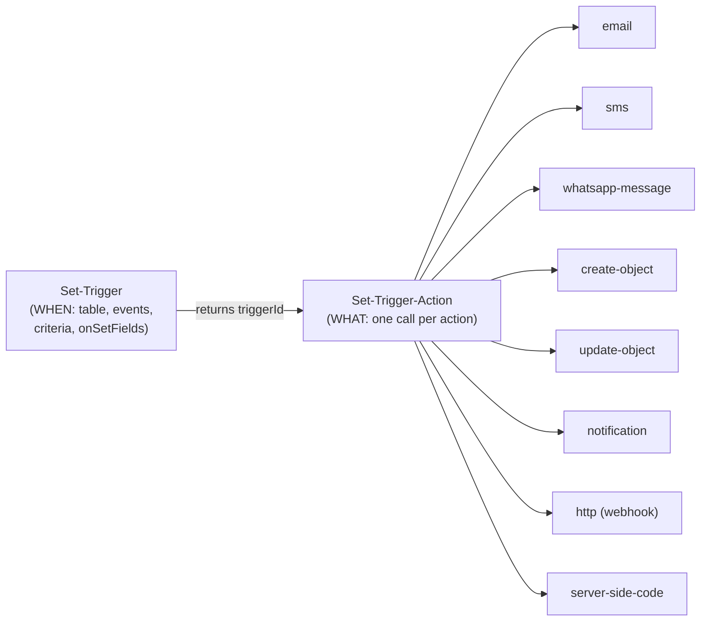

# Triggers & Automations — the Server-Side Automation Engine

> **Purpose:** Complete reference for the trigger engine — טריגר (Trigger) / אוטומציה (Automation) — in MyBusiness CRM: event types, condition formats, all 8 action types, scheduled triggers, dynamic placeholders, chains, logging and debugging — plus scheduled jobs (clock-based function/agent runs, §14). Spec-ready for AI implementers.
> **Last updated:** 2026-11-03 (§5.9 `trigger-ai-agent`, §8 two trigger levels, scheduled-trigger timing measured 2026-10-25/26, keys in http actions) · previously 2026-11-03 (§14.1 a scheduled trigger cannot run an agent; §14.7 business hours, owner-only screen, `jobId` vs `_id`) · previously 2026-11-01 (§14 scheduled jobs — clock-based function/agent runs via `Get-Scheduled-Jobs` / `Create-or-Update-Scheduled-Job`, measured live; limitations 17-20) · previously 2026-07-28 (§13 User-Assignments round-robin engine — rule shape, the הקצאה כאשר→events mapping, measured rotation/cap/latency/fairness) · **Status:** draft

## 1. Architecture — two-step model

A trigger is split into **WHEN** (the trigger itself) and **WHAT** (one or more actions). They are configured by two separate MCP tools, always in this order:



Triggers live **per table** (stored on the class schema; `Get-Triggers` returns them grouped by `className`). Scheduled triggers are stored separately and returned in a `scheduledTriggers` array.

### Trigger types (verified)

| Type (`type` param) | Fires when | Key params |
|---|---|---|
| `"data change"` | A record is created and/or updated | `events: ["create"]` / `["update"]` / `["create","update"]`, `onSetFields`, `criterias`, `oneachupdate` |
| `"scheduled"` | X hours before/after a Date field's value on each matching record | `schedulerField`, `shcedulerHours` (note the typo — it is the real param name), `criterias` |

A third trigger type, **"Add to Timeline"**, exists in the admin UI only — it is not configurable via MCP (per `myb-p-trigger-setup` skill).

## 2. Condition format — CANONICAL (quoted from `Usage-Guide`)

The MCP `Usage-Guide` tool is the canonical source for condition structure. Quoted verbatim (called live 2026-06-10):

> במערכת יש כמה מקומות שאפשר לתת תנאים (conditions).
> המבנה של תנאים הוא מערך של objects עם המאפיינים הבאים:
> ```
> {
>     "field": "field name", - the name of the field to compare
>     "equesition": "equation type", - the type of the comparison (equalTo, greaterThan, lessThan, greaterThanOrEqualTo, lessThanOrEqualTo, notEqualTo, containedIn, notContainedIn, exists, notExist, startsWith, endsWith, contains)
>     "value": "value" - the value to compare to (can be empty string). For pointer field the value is the objectId. In some cases when the pointer is to _User table, the value can be "currentUser". For date field the value can be "year ago", "beginning of this year", "30 days period", "beginning of this month", "today", "end of this month", "end of next month", "end of this year", "year ahead", YYYY-MM-DD, or a number of days to add (can be negative).
>     "visibleVal": "label" - optional, can be a description of the value. For example, for pointer objectId the visibleVal will be the Name property of the object.
> }
> ```
> או שהתנאים יהיו במבנה הבאה:
> ```
> {
>     "F": - field name
>     "C": - condition (equation) type
>     "T": - type of the value
>     "V": - value to compare to
>     "P": - pointer to another object
> }
> ```

Two equivalent shapes exist across the platform:

| Shape | Where used | Keys |
|---|---|---|
| **`equesition` shape** (long-key) | Form rules, report `QueryElems`, some query elements | `field`, `equesition`, `value`, `visibleVal`, `condOr` |
| **`F/C/T/V/P` shape** (short-key) | **Trigger `criterias`** (this doc), table-view filters, counters/charts | `F`, `FText`, `C`, `T`, `V`, `P`, `condOr` |

Note the deliberate spelling **`equesition`** (not "equation"/"condition") — it is the actual stored key.

### 2.1 Trigger criteria object (F/C/T/V/P shape) — field-by-field

```json
{
  "F": "SaleStatusId",
  "FText": "SaleStatusId",
  "C": "equalTo",
  "V": "zrP1MSVBoq",
  "T": "Pointer",
  "P": { "targetClass": "SaleStatuses", "visibleVal": "הושלמה", "multiple": false },
  "condOr": false
}
```

| Key | Required | Meaning |
|---|---|---|
| `F` | yes | Field name. Supports dot notation into pointers, e.g. `OwnerId._User.name` |
| `FText` | recommended | Display label (usually same as `F`) |
| `C` | yes | Operator (see below) |
| `V` | yes (except exists) | Value. Pointer → objectId string; `containedIn` → array of objectIds; Number → number; Boolean → `true`/`false`; Date → keyword/`YYYY-MM-DD`/day-offset number |
| `T` | yes | Value type: `String`, `Number`, `Pointer`, `Boolean`, `Date` (also seen live: `PrivateFile` with `C: "exists"`, `Array`) |
| `P` | for Pointer | `{ "targetClass": "...", "visibleVal": "...", "multiple": false }` — `multiple: true` when `V` is an array (`containedIn`) |
| `condOr` | optional | `true` puts this criterion into the OR group (needs ≥2 OR criteria to matter) |

### 2.2 Operators

| Operator (`C` / `equesition`) | Types | Notes |
|---|---|---|
| `equalTo` / `notEqualTo` | all | Pointer compares objectId |
| `greaterThan` / `lessThan` / `greaterThanOrEqualTo` / `lessThanOrEqualTo` | Number, Date | |
| `contains` / `startsWith` / `endsWith` | String | Verified live: `{"F":"Name","C":"contains","T":"String","V":"בע\"מ"}` |
| `containedIn` / `notContainedIn` | Pointer (array `V`) | `P.multiple: true`; live example with 6 doc-type ids on `AccountingHeaders` |
| `exists` / `notExist` | any | No `V` needed. Live example: `{"F":"File","C":"exists","T":"PrivateFile"}` |

⚠️ Observed in stored form-rule data (not triggers): an `"empty"` operator and a `"equealTo"` typo are tolerated by the runtime — treat stored data as potentially non-canonical when auditing (see `07-form-rules.md`).

### 2.3 AND / OR semantics (hands-on verified)

- Criteria **without** `condOr` are ANDed — all must match.
- Criteria **with** `condOr: true` form one OR group — at least one must match.
- Both can coexist: AND criteria must all hold **and** at least one OR criterion must hold. Verified live (trigger `TEST16`):

```json
"criterias": [
  { "F": "Total", "C": "greaterThan", "T": "Number", "V": 5000 },
  { "F": "SaleStatusId", "C": "equalTo", "T": "Pointer", "V": "zrP1MSVBoq",
    "P": { "targetClass": "SaleStatuses", "visibleVal": "הושלמה" }, "condOr": true },
  { "F": "SaleStatusId", "C": "equalTo", "T": "Pointer", "V": "V0sVNyS45K",
    "P": { "targetClass": "SaleStatuses", "visibleVal": "משא ומתן" }, "condOr": true }
]
```

## 3. `Set-Trigger` — parameter spec

| Parameter | Type | Required | Description |
|---|---|---|---|
| `tableName` | String | yes | Table to monitor |
| `type` | Enum | yes | `"data change"` or `"scheduled"` |
| `active` | Boolean | yes | Enable/disable. ⚠️ In stored data, **absence of the field means active** (verified in the investigation method skill) |
| `name` | String | yes (create) | Descriptive name (Hebrew recommended) |
| `_id` | String | update only | Existing trigger id — pass to update/deactivate |
| `events` | Array | data change | `["create"]`, `["update"]`, `["create","update"]` |
| `onSetFields` | Array | recommended | Fields watched — trigger evaluates only if one of them changed. For `create` events use a field that is always set (convention: `["Name"]`). Empty `[]` = evaluate on ANY change (works, not recommended) |
| `criterias` | Array | no | F/C/T/V/P objects (section 2.1) |
| `oneachupdate` | Boolean | no | `false` (default) = fires once per record, the record is marked processed; `true` = fires on every matching update |
| `schedulerField` | String | scheduled | Date field on the table to schedule from |
| `shcedulerHours` | Number | scheduled | Hours **before** (positive) or **after** (negative) the date. **The typo is the real parameter name.** |

### Return values — two different ID formats (hands-on verified)

| Trigger type | Return | Where the id is |
|---|---|---|
| data change | Full class schema with `triggers` array | Find your trigger by `name`, use its `_id` (Parse-style, e.g. `"9ht1ary5dW"`) |
| scheduled | `{"value":"69df53414167a73a568f34df"}` | Use the `value` (MongoDB ObjectId format) as `triggerId` |

### Scheduled trigger timing

| `shcedulerHours` | Meaning |
|---|---|
| `720` | 30 days before the date |
| `24` | 1 day before |
| `2` | 2 hours before |
| `1` | 1 hour before (**minimum "before"**) |
| `-1` | 1 hour after (**minimum "after"; use for "on/just-after the date"**) |
| `-48` | 2 days after |

⚠️ **`shcedulerHours: 0` is rejected** with `"Scheduler hours is required"` (hands-on verified in the trigger skill and SLA skill). The older `mcp-tool-guides.md` claims `0` = "exactly at the date" — that documentation is outdated; trust the verified behavior. Note: two legacy platform-template scheduled triggers in the playground (`TaskReminder`, `Activity Reminder`) do carry `shcedulerHours: "0"` — they were created by provisioning, not via the MCP path.

**Measured 2026-10-25/26:**
- **Fractional `shcedulerHours` are rounded down to a whole hour.** `-0.5`, `-0.2` and `-0.01` fired 1 h after the date; `+0.5` fired at the date. A fraction never gives sub-hour timing, and a leftover `-0.5` fires an hour late.
- **`0`:** the MCP tool text now describes `0` as "on time". Re-test before relying on it; `+0.5` behaved as `0`.
- **Accuracy:** the scheduler ran in passes about every 10 minutes, at fixed minutes, so expect about ±10 minutes (offsets −9 to +3 min measured).
- **Sub-hour delay pattern:** a data-change trigger sets a date field to the event time shifted by (X − 60) minutes with `timeGap`, and a `-1` scheduled trigger watches that field (X = 10 fired at 10.6 min). This does not work on a table the server saves without triggers (e.g. `AiActivities`). For clock-based work, prefer a scheduled job (§14).
- **Other scheduled-trigger behaviour:**
  - it leaves no `_syslogTriggers` row;
  - `Set-Trigger` on an existing scheduled trigger replaces its data;
  - its actions do not resolve pointer paths (`AccountId.Name`);
  - an `http` action from it to the MyAgents server gets 403;
  - the AI-agent action never runs from it (§5.9).

Scheduler semantics: the platform scheduler continuously scans records whose `schedulerField` is X hours away, evaluates `criterias` **at fire time** (not creation time), and runs the actions. Expect a few minutes' resolution, not exact-minute delivery. The date field must hold a real future (or recently passed, for negative hours) value.

## 4. `Set-Trigger-Action` — parameter spec

| Parameter | Type | Required | Description |
|---|---|---|---|
| `tableName` | String | yes | Same table as the trigger |
| `triggerId` | String | yes | From Set-Trigger return (see ID formats above) |
| `triggerType` | Enum | yes | `"data change"` / `"scheduled"` — must match the trigger |
| `actionType` | Enum | yes | One of the 8 types below |
| `actionData` | Object | yes | `{ "<actionType>": { ...params } }` — keyed by the action type |
| `actionId` | String | update/delete | Data-change triggers: the action's `_id`; **scheduled triggers: zero-based index as string** (`"0"`, `"1"`) |
| `deleteAction` | Boolean | delete | ⚠️ Even with `deleteAction: true` you MUST send a structurally valid `actionData` — otherwise `"Cannot read properties of undefined"` |

Multiple actions per trigger: call `Set-Trigger-Action` repeatedly with the same `triggerId`; actions append and run in order (verified: notification + http on one trigger).

## 5. The 8 action types (all verified working via MCP)

The MCP `Set-Trigger-Action` enum (2026-11) has two more: `trigger-ai-agent` (§5.9, verified) and `update-user-role` (not documented or tested yet).

### 5.1 `email`

Prerequisites: SMTP account objectId (`Get-SMTP-Accounts`), email template objectId (`Get-Data` on `EmailTemplate` — templates must be created in the UI first).

```json
{
  "actionType": "email",
  "actionData": {
    "email": {
      "emailType": "field",
      "emailTarget": "Email",
      "emailSubject": "Subject with {{{Name}}} dynamic content",
      "emailAccount": "<smtpAccountObjectId>",
      "template": "<emailTemplateObjectId>",
      "saveToEmailsTable": true,
      "fieldsValue": [
        { "field": "AccountId", "targetClass": "Accounts", "type": "Pointer",
          "value": "AccountId", "visibleVal": "Account" },
        { "field": "SaleId", "targetClass": "Sales", "type": "Pointer",
          "value": "current", "visibleVal": "Current Object(Sales)" }
      ]
    }
  }
}
```

| Param | Values | Notes |
|---|---|---|
| `emailType` | `"fixed"` / `"field"` | fixed = hardcoded address; field = read from the record |
| `emailTarget` | address or field name | Pointer traversal works: `"OwnerId.email"`, `"AccountId.Accounts.Email"` (verified) |
| `emailSubject` | string | `{{{Field}}}` and `.format(...)` work in subjects too (verified) |
| `saveToEmailsTable` | bool | Saves a copy in `Emails`; `fieldsValue` links pointers on the saved record |

### 5.2 `sms`

```json
{
  "actionType": "sms",
  "actionData": {
    "sms": {
      "toType": "field",
      "to": "PhoneNumber",
      "from": "0501234567",
      "local": "IL",
      "content": "שלום {{{AccountId.Name}}}, הזמנתך #{{{Name}}} בסך {{{Total}}} ש\"ח התקבלה!",
      "useQueue": true
    }
  }
}
```

`toType` fixed/field; `local` is a country code (`"IL"`, `"US"`, can be `""`); `useQueue: true` recommended for bulk.

### 5.3 `whatsapp-message`

Prerequisites: `Send-WhatsApp-Message(getNumbers: true, getTemplates: true)` for the channel `from` value (phone-number ID, **not** an objectId — and per project rules, the `Identity` field from Channels, not `objectId`) and the approved template object.

```json
{
  "actionType": "whatsapp-message",
  "actionData": {
    "whatsapp-message": {
      "toType": "field",
      "to": "PhoneNumber",
      "from": "<channelIdentityId>",
      "waba_id": "<wabaId>",
      "message": "Description text",
      "template": {
        "name": "template_name", "parameter_format": "POSITIONAL",
        "components": [ "...full components from getTemplates..." ],
        "language": "he", "status": "APPROVED", "category": "MARKETING",
        "id": "<templateId>"
      },
      "WATemplateParams": { "BODY": ["{{{AccountId.Name}}}", "{{{Name}}}"] }
    }
  }
}
```

⚠️ **`Get-WhatsApp-Template-Params` is unreliable for templates with 2+ BODY params** (verified test, 2026-04-15): it returns only the FIRST `example.body_text` element. Workaround: count the `{{N}}` placeholders in the template `text` yourself and build `WATemplateParams.BODY` with one entry per placeholder, in order. For an IMAGE header, `WATemplateParams.HEADER` = the image URL.

### 5.4 `create-object`

```json
{
  "actionType": "create-object",
  "actionData": {
    "create-object": {
      "targetClass": "Tasks",
      "fieldsValue": [
        { "field": "Name", "type": "static", "value": "Follow up task" },
        { "field": "SaleId", "type": "dynamic", "value": "currentObject", "targetClass": "Sales" },
        { "field": "AccountId", "type": "dynamic", "value": "AccountId", "targetClass": "Accounts" },
        { "field": "OwnerId", "type": "dynamic", "value": "OwnerId", "targetClass": "_User" },
        { "field": "Date", "type": "dynamic", "value": "updatedAt", "timeGap": 1440 },
        { "field": "StatusId", "type": "static", "value": "<statusObjectId>",
          "targetClass": "TaskStatuses", "visibleVal": "פתוחה" }
      ]
    }
  }
}
```

### 5.5 `update-object` — connection semantics

| `connection` | Meaning | Example |
|---|---|---|
| `"current.objectId"` | Update the triggered record itself (**the only working self-update value** — `self`, `objectId`, `target.objectId`, `source.objectId` all fail with `"missing type or field"`) | Stamp a timestamp field on the same Sale |
| `"source.<PointerField>"` | The triggered record points **to** the target | Trigger on Sales → update the linked Account via `source.AccountId` |
| `"target.<PointerField>"` | Target records point **to** the triggered record (updates ALL of them) | Trigger on Sales → update all SaleRows via `target.SaleId` |

```json
{
  "actionType": "update-object",
  "actionData": {
    "update-object": {
      "targetClass": "Sales",
      "connection": "current.objectId",
      "fieldsValue": [
        { "field": "OwnerSetDate", "type": "dynamic", "value": "updatedAt", "visibleVal": "updatedAt" }
      ]
    }
  }
}
```

Cross-table dot-notation in `fieldsValue` is supported (live example on `SaleRows`): `{ "field": "AccountId", "type": "dynamic", "value": "SaleId.Sales.AccountId", "targetClass": "Accounts" }` — copies the Account pointer from the parent Sale.

### 5.6 `notification` (in-app)

```json
{
  "actionType": "notification",
  "actionData": {
    "notification": {
      "userType": "field",
      "user": "OwnerId",
      "content": "<div>פנייה חדשה: <b>{{{Name}}}</b><br/>לקוח: {{{AccountId.Name}}}</div>",
      "icon": "fa-bell",
      "iconColor": "#4CAF50"
    }
  }
}
```

`userType` `"fixed"` (user objectId) / `"field"` (field pointing to `_User`). Content supports **HTML** (`<div>`, `<b>`, `<br/>` verified). Icons are FontAwesome 3/4-style classes (`fa-bell`, `fa-envelope`, `fa-clock-o`, `fa-trophy`, `fa-exclamation-triangle`, `fa-calendar`…); `iconColor` is hex.

### 5.7 `http` (webhook)

```json
{
  "actionType": "http",
  "actionData": {
    "http": {
      "url": "https://hooks.example.com/webhook/abc?sale={{{objectId}}}&name={{{Name}}}",
      "method": "POST",
      "useQueue": true,
      "headers": [
        { "name": "Content-Type", "value": "application/json" },
        { "name": "X-Trigger-Source", "value": "MyBusiness-CRM" }
      ]
    }
  }
}
```

`method`: `GET` / `POST` / `PUT` / `DELETE` / `AUTO` (AUTO = POST on create, PUT on update). **The request body is automatically the full record JSON.** `{{{Field}}}` placeholders work inside the URL. Platform-internal automations use this action too (live example: inventory update calling `https://apps.simbla.com/functions/src-application-id/inventory-update`).

**Keys in `http` actions are exposed:** on a table with a keyed `http` action, `Set-Trigger`, `Set-Trigger-Action` and `Get-Triggers` print every key. `_syslogTriggers` stores the keyed URL when the call fails. Read and edit such triggers through a script that filters secrets, and never paste their output (measured 2026-10-25).

### 5.8 `server-side-code`

```json
{
  "actionType": "server-side-code",
  "actionData": {
    "server-side-code": { "functionName": "calculateCommission", "useQueue": true }
  }
}
```

Runs a pre-deployed cloud function with the triggered record as context. MCP cannot create cloud functions — the function must already exist (dev-team deliverable). Use for anything beyond declarative actions: business-day math, SLASettings lookups, aggregation/summing, conditional branching.

### 5.9 `trigger-ai-agent` — run a MyAgents AI agent

```json
{
  "actionType": "trigger-ai-agent",
  "actionData": { "trigger-ai-agent": { "agentId": "<AiAgents objectId>", "agentName": "<agent name>" } }
}
```

**What it does:**
- Starts a MyAgents agent (text or voice) when the trigger fires on **create or update** (measured 2026-10-25/26: a text agent started about 1 s after a save, at about 0.3 credits). Runs are queued per agent; a brand-new agent's first run starts about a minute late.
- **The agent receives the raw saved record** as JSON: `{"object":{…the row, pointers as bare ids…},"event","time","trriger","objectClass"}`. There is no message template, so the agent's prompt must say what to read and what to do. A voice agent dials the first phone-like number in it.
- **The agent's business hours apply:** outside them the run is queued or refused ([MyAgents](../10-modules/09-myagents.md) §7-§8).

**When it does not run:**
- **on delete**;
- **from a scheduled (date-field) trigger** (measured 2026-10-29) — use a scheduled job (§14);
- **from a trigger on `AiActivities`**: the agent server's own saves fire no data-change triggers, so nothing can chain off an agent's result (measured 3 times).

**Verifying and safety:**
- It leaves **no `_syslogTriggers` row of its own**. Verify by the agent's output (the activity, or the record it wrote).
- **Before an agent writes to a vanilla table, read that table's triggers.** On one tenant, Activity triggers synced to Outlook when both `StartTime` and `EndTime` were set, and another stamped the account's `LastUpdate`.

## 6. Field value types in `fieldsValue` (create-object / update-object)

| `type` | `value` | Notes |
|---|---|---|
| `static` | literal string / number / boolean / objectId | For Pointer targets add `targetClass` + `visibleVal` |
| `dynamic` | field name on the triggered record | For Pointer fields add `targetClass` |

### Special dynamic values

| Value | Meaning |
|---|---|
| `"currentObject"` | Pointer to the record that fired the trigger |
| `"updatedAt"` | Timestamp of the firing moment |
| `"createdAt"` | The record's creation timestamp |
| `"updatedBy"` | The user who made the change (Pointer → `_User`) |
| `"currentUser"` | Currently logged-in user (static type) |

### `timeGap` — date arithmetic in **minutes**

Attach to a `dynamic` Date entry: `{ "field": "DueDate", "type": "dynamic", "value": "updatedAt", "timeGap": 1440 }`.

| Minutes | Duration |
|---|---|
| `60` | 1 hour |
| `1440` | 1 day |
| `2880` | 2 days |
| `10080` | 1 week |
| `43200` | 30 days |
| `-1440` | 1 day back |

`timeGap` adds **calendar** minutes — it does not consult business hours (see SLA blueprint in `12-solution-blueprints.md` for business-day workarounds).

## 7. Dynamic content placeholders (CANONICAL, from `Usage-Guide`)

Quoted verbatim:

> לדוגמא `'Hi {{{Name}}}'` או `'Hi {{{AccountId.Name}}}'` יוחלף בערך של השדה Name או AccountId.Name ברשומת הנתונים.
> לשדה מסוג תאריך ניתן לקבוע את הפורמט של התאריך. לדוגמא `{{{SaleDate.format(date,he-IL,Asia/Jerusalem)}}}`. הערך הראשון בפונקציה פורמט הוא הסוג של התאריך (date, timehm, datetime). הערך השני הוא השפה של התאריך. הערך השלישי הוא האיזור של התאריך.

| Syntax | Result |
|---|---|
| `{{{Name}}}` | Field from the triggered record |
| `{{{AccountId.Name}}}` | One-level pointer traversal |
| `{{{OwnerId.name}}}` | `_User` fields are lowercase (`name`, `email`) |
| `{{{objectId}}}` | Record id |
| `{{{Date.format(date,he-IL,Asia/Jerusalem)}}}` | Date only |
| `{{{Date.format(timehm,he-IL,Asia/Jerusalem)}}}` | Time HH:MM |
| `{{{Date.format(datetime,he-IL,Asia/Jerusalem)}}}` | Date + time |

Usable in: email subjects + bodies, SMS content, notification content, HTTP URLs, WhatsApp `WATemplateParams`. Triple braces are required (`{{{ }}}` — quote-template placeholders in `10-price-quotes-documents.md` use double braces `{{ }}`; do not confuse the two systems).

## 8. Trigger chains

- A trigger action that writes data can fire other triggers. **In practice there are two trigger levels:** a user save fires T1, T1's write fires T2, and T2's writes fire nothing (measured 2026-10-21; the MCP `Set-Trigger` text describes the same). Older documentation said "maximum chain depth 3" and `"Max trigger depth reached"`.
- **A write back to the same record from a chained trigger is blocked.** The log shows `blocked! dontRunSimblaTriggersUpdate is set to true` (measured 2026-10-25).
- Self-update loops (trigger on table X updates table X) are bounded by `onSetFields` — make sure the field your action writes is NOT in the trigger's own `onSetFields`.
- Keep escalation/notification actions (email/SMS/notification) at the chain ends — they don't propagate chains.

## 9. Critical execution rule — triggers DO fire on API/Master-key writes (suppression is opt-in)

**Live-verified on the playground, 2026-06-10, all write paths** (test: Cases create-triggers "SLA: הגדרת דד-ליין" + "SLA-Process: שורת מעקב", Sales update-trigger "תיעוד תאריך הגדרת אחראי"):

| Write path (master key, via MCP) | Result |
|---|---|
| `Create-Data` | ✅ Create-triggers fired: `update-object` stamped `SLADeadline` (+2880 min exactly), `create-object` created the `CaseSLAProcess` row ~200 ms after save |
| `Update-Data` | ✅ `onSetFields` update-trigger fired: `OwnerSetDate` stamped with the write's `updatedAt` |
| `Create-Many` (default) | ✅ Create-triggers fired (same SLA effects) |
| `Create-Many` + `skipTriggers: true` | ⛔ All create-triggers suppressed — no stamp, no child row (`updatedAt == createdAt`). AutoIncrement still ran. Master-key-only flag; `skipTimeline: true` similarly suppresses audit entries |

Implications:

1. **Bulk imports fire automations by default** — a 5,000-row import can send 5,000 emails and create 5,000 child rows. Decide per import: suppress with `Create-Many(skipTriggers: true)` and backfill trigger-derived fields in the import, or deliberately let triggers run (e.g., to build SLA tracking rows) after deactivating notification-type actions for the window.
2. **API testing of triggers is valid** — UI and API writes behave the same for data-change triggers. (Client-side **form rules** are a different mechanism and still apply only in the form UI — see `07-form-rules.md`.)
3. **Single-record `Create-Data`/`Update-Data` and REST `/batch` have no skip flag** — only `Create-Many` exposes suppression (see `../40-integrations-api/01-parse-rest-api.md`).

> History note: earlier internal material claimed triggers do not fire on master-key writes; the live test above refutes that as a general rule. If a trigger appears not to fire on an API write, suspect its `criterias` / `onSetFields` (was the watched field actually changed?), `oneachupdate` one-shot semantics, or the 3-level chain cap — and check `_syslogTriggers` / `_Timeline` — before blaming the write path.

## 10. Logging & debugging

### 10.1 `_syslogTriggers` — trigger execution log

```
Get-Data(table: "_syslogTriggers", order: "-createdAt", limit: 10,
         keys: ["triggerId", "triggerName", "error", "status", "createdAt", "tableName"])
// per-record investigation:
Get-Data(table: "_syslogTriggers", where: {"objectIdValue": "<recordId>"}, order: "createdAt")
```

Schema highlights: `objectIdValue`, `triggerId`, `actionId`, `event`, `error`, `data`. Common `error` values:

| Error | Root cause |
|---|---|
| `"missing type or field"` | Wrong `connection` value or field type in update-object (use exactly `current.objectId` for self-update) |
| `"Can not find record"` | `source.`/`target.` connection found no related record |
| `"Max trigger depth reached"` | Chain exceeded 3 levels |

⚠️ Not all environments persist `_syslogTriggers`. An empty result does **not** prove the trigger didn't run — fall back to `_Timeline`.

### 10.2 `_Timeline` — ground truth (from the investigation method skill)

```
Get-Data(table: "_Timeline",
  where: { "objectIdValue": "<recordObjectId>", "objectClass": "Cases" },
  keys: ["createdAt", "event", "data", "user"], order: "createdAt", limit: 50)
```

| Timeline field | Reading |
|---|---|
| `event` | `"create"` / `"update"` |
| `data` | The changed fields + new values |
| `user.objectId === "Master"` | Change made by a trigger / cloud function / API |
| `user.objectId === "<userId>"` | Manual change by that user |
| `data.updatedByTrigger` | objectId of the specific trigger that caused the change (not always present) |

Timestamps are UTC; Israel = UTC+2 (winter) / UTC+3 (summer).

### 10.3 Investigation playbook ("the automation didn't run")

1. Fetch the record (`Get-Data`) — verify it is the record/date the customer means.
2. `_Timeline` for the record — what actually happened, in order, by whom.
3. `_syslogTriggers` for the record — errors (absence ≠ proof).
4. `Get-Triggers(tableName)` — check `active` (absence of the key = active), `events`, `criterias` vs the record's actual values at event time, `onSetFields` vs which field changed, `oneachupdate` (false + already fired once = won't fire again).
5. If `server-side-code` — read the function source; look for early-exit guards (`if (req.body.X) throw ...`) and hardcoded objectId lists.
6. If `http` — identify the cloud function from the URL; some (e.g. `update_sum_count_obj`) are configured via the `Config` table (reachable from MCP since 2026-09) (`UpdateSumCountOnCls_<Table>` rows) reachable only via Parse REST with Master Key.

### Trigger not firing — quick table

| Symptom | Likely cause |
|---|---|
| Never fires | inactive; criteria mismatch (wrong objectId/type); changed field not in `onSetFields`; record was written with `Create-Many(skipTriggers: true)` |
| Fired once, never again | `oneachupdate: false` |
| Email not sent | wrong SMTP/template objectId |
| WhatsApp not sent | `from` is an objectId instead of channel Identity; template not APPROVED |
| Scheduled never fires | `schedulerField` empty/past; `shcedulerHours: 0` rejected at creation |
| Action create failed | `actionData` key doesn't match `actionType`; `triggerType` mismatch; wrong id format for scheduled triggers |

## 11. Worked examples (live, from playground `Get-Triggers`)

### 11.1 New-case notification to owner (create event)

```json
{
  "name": "פנייה חדשה - התראה לאחראי",
  "events": ["create"], "criterias": [], "active": true, "onSetFields": ["Name"],
  "actions": [{
    "type": "notification", "userType": "field", "user": "OwnerId",
    "content": "<div>פנייה חדשה: <b>{{{Name}}}</b><br/>לקוח: {{{AccountId.Name}}}<br/>טלפון: {{{PhoneNumber}}}</div>",
    "icon": "fa-envelope", "iconColor": "#2196F3"
  }]
}
```

### 11.2 Timestamp-on-owner-change (the timestamp pattern, see `11-field-patterns.md`)

```json
{
  "name": "תיעוד תאריך הגדרת אחראי",
  "events": ["create", "update"], "criterias": [], "oneachupdate": true,
  "onSetFields": ["OwnerId"],
  "actions": [{
    "type": "update-object", "targetClass": "Sales", "connection": "current.objectId",
    "fieldsValue": [{ "field": "OwnerSetDate", "type": "dynamic", "value": "updatedAt" }]
  }]
}
```

### 11.3 Cross-table update via `target.` (task completion closes the case)

```json
{
  "name": "משימה הושלמה - עדכון פנייה",
  "events": ["update"], "onSetFields": ["StatusId"], "oneachupdate": false,
  "criterias": [{ "F": "StatusId", "C": "equalTo", "T": "Pointer", "V": "czzdnGDqgJ",
                  "P": { "targetClass": "TaskStatuses", "visibleVal": "בוצעה" } }],
  "actions": [{
    "type": "update-object", "targetClass": "Cases", "connection": "target.TaskId",
    "fieldsValue": [{ "field": "IsClosed", "type": "static", "value": true }]
  }]
}
```

### 11.4 Scheduled reminder 24h before closing date + criteria at fire time

```json
{
  "name": "תזכורת לפני תאריך סגירה", "type": "scheduled",
  "schedulerField": "ClosingDate", "shcedulerHours": "24",
  "criterias": [
    { "F": "IsWon", "C": "notEqualTo", "T": "Boolean", "V": true },
    { "F": "IsLost", "C": "notEqualTo", "T": "Boolean", "V": true }
  ],
  "actions": [{
    "type": "notification", "userType": "field", "user": "OwnerId",
    "content": "תזכורת: המכירה {{{Name}}} אמורה להיסגר מחר. תאריך סגירה: {{{ClosingDate.format(date,he-IL,Asia/Jerusalem)}}}",
    "icon": "fa-clock-o", "iconColor": "#FF9800"
  }]
}
```

### 11.5 Big-deal alert: number criteria + multi-action (notification + webhook)

```json
{
  "name": "Number criteria - עסקה גדולה",
  "events": ["create", "update"], "onSetFields": ["Total"], "oneachupdate": false,
  "criterias": [{ "F": "Total", "C": "greaterThan", "T": "Number", "V": 10000 }],
  "actions": [
    { "type": "notification", "userType": "fixed", "user": "2b0QVKoigE",
      "content": "עסקה גדולה! {{{Name}}} - סכום: {{{Total}}} ש\"ח", "icon": "fa-exclamation", "iconColor": "#ff4444" },
    { "type": "http", "url": "https://httpbin.org/post?sale={{{objectId}}}&name={{{Name}}}",
      "method": "POST", "useQueue": true,
      "headers": [{ "name": "Content-Type", "value": "application/json" }] }
  ]
}
```

### 11.6 Trigger-driven full-stack patterns

End-to-end compositions (SLA deadline stamping, per-status tracking rows, escalation) are catalogued in `12-solution-blueprints.md`. Common one-liners:

| Pattern | Trigger | Action |
|---|---|---|
| Status-change notification | `events:["update"]`, `onSetFields:["StatusId"]`, status criteria | notification / email / sms |
| Welcome email on create | `events:["create"]` | email |
| Auto follow-up task | update + completion criteria | create-object (Tasks), `DueDate = updatedAt + 1440` |
| Field sync between tables | update + `onSetFields` | update-object `source.`/`target.` |
| Lead→customer flag | `IsAccount equalTo true` criteria | update-object `current.objectId` (live: `Account Lead Status`) |
| Webhook to ERP/marketing | create/update | http POST |

## 12. Managing existing triggers

| Operation | How |
|---|---|
| Update trigger | `Set-Trigger` with `_id` + fields to change |
| Deactivate | `Set-Trigger(_id, tableName, type, active: false)` |
| **Delete trigger** | **Not possible via MCP** — only deactivate. Hard delete: Admin UI → Databases → Tables → [Table] → Triggers |
| Update action | `Set-Trigger-Action` with `actionId` + full new `actionData` |
| Delete action | `Set-Trigger-Action` with `actionId`, `deleteAction: true` **and** dummy-but-valid `actionData` |
| List | `Get-Triggers()` (all) / `Get-Triggers(tableName)` |

## 13. User-Assignments — the productised round-robin engine

**What it is:** a settings screen (`הגדרות הקצאות משתמשים`, `apps/mybusiness/user-assignments`) that
auto-assigns incoming records to a rotating pool of users. It is **not** a hand-rolled trigger recipe —
it is a product feature whose rules are rows in `UsersAssignments`, each backed by a companion trigger
the screen creates for you. Installing it into a tenant is a guided setup (settings page + menu entry + hosted JS).


> **Availability (verify before promising).** The settings screen is **not part of a vanilla
> tenant** — checked 2026-07-28, a fresh app carries only MyChat's `settings-users-assignment`.
> It is installed per tenant as a guided setup. Confirm with `Get-Site-Pages` that
> `apps/mybusiness/user-assignments` exists before scoping it into a fit-gap.

### 13.1 The rule row (`UsersAssignments`)

| Field | Meaning |
|---|---|
| `Name` | Rule name |
| `Table` | Table the rule watches (Accounts / Cases / Sales / any) |
| `AssignmentField` | The pointer-to-`_User` field that gets filled (e.g. `OwnerId`, `LeadOwnerId`) |
| `Users` | Array of `_User` pointers — **array order IS the rotation order** |
| `LastAssignmentUserId` | The rotation cursor (last user served). Exposed in the form as "משתמש אחרון שקיבל הקצאה" so the cursor can be seeded/reset |
| `MaximumAssignmentForUser` | Optional cap per user; empty or `0` = no cap |
| `MaximumAssignmentConditions` | F/C/T/V/P criteria defining **which records count** toward that cap (e.g. status = פתוח) |
| `ActiveStatuses` | Optional filter on user presence status; leave empty to ignore |
| `Active` | Rule on/off |

### 13.2 What saving a rule creates

Saving writes the row **and** a companion `data change` trigger named `User Assignments` on
`Table`, whose single action is `http` → `https://api.mbapps.co.il/functions/<appId>/user_assignments?assignmentId=<ruleId>`
with `useQueue: true`.

> **The single most important setup fact.** The form's **"הקצאה כאשר"** checkboxes —
> **ביצירת רשומה** and **בעדכון רשומה** — are what populate that trigger's `events`.
> Leave both unticked and the trigger is created with **`events: []`**, which by design never fires:
> the rule shows as *פעיל*, the screen gives no warning, and **nothing is ever assigned**.
> This is correct engine behaviour, not a defect — but it is the #1 cause of "the mechanism does
> nothing" reports. Always confirm at least `ביצירת רשומה` is ticked, and verify with
> `Get-Triggers(<Table>)` that `events` is non-empty.

### 13.3 Runtime behaviour (measured)

| Aspect | Verified behaviour |
|---|---|
| Rotation | Per-record round-robin over `Users` in array order; cursor advances one user per assigned record |
| Cap | Users at `MaximumAssignmentForUser` (counted against `MaximumAssignmentConditions`) are skipped; when **all** are at cap **no assignment happens**; a user dropping below cap re-enters the rotation |
| Latency, single record | Assignment is written in **well under a second** (measured 0.3–0.7 s) |
| Latency, 10 concurrent creates | 0.4–9.2 s — the queue serialises the calls |
| Fairness under load | With `useQueue: true`, three separate 10-way bursts each produced a **perfect even split** (2/2/2/2/2). The same bursts with `useQueue` off skewed badly (spreads of 2, 4 and 4; one rep received 5 while another received 0) |
| Records created while misconfigured | **Never assigned retroactively** — fixing the rule later does not sweep them; they need manual assignment |
| Pre-filled owner | A record created with the assignment field already populated is left untouched |

**Therefore: keep `useQueue: true`.** The few seconds it costs under burst is what buys the even
distribution; turning it off restores the skew.

### 13.4 Operational gotchas

1. **Deleting a rule from the screen leaves the companion trigger behind** as an orphan pointing at a
   non-existent `assignmentId`. It is a no-op per record but still costs a queued call on every write —
   deactivate or hard-delete it (UI only; MCP cannot delete triggers).
2. **`UsersAssignments` is shared with MyChat**, which uses the same table for channel assignment
   groups via `Channels.UsersAssignmentId` (see [10/04](../10-modules/04-mychat.md)). Never delete or
   repurpose rows you did not create.
3. **Editing a rule does not repair a trigger that was created with empty `events`** — the edit path
   preserves whatever events exist but never adds them. Re-tick the checkboxes, or patch with
   `Set-Trigger { _id, events: ["create","update"] }`.
4. The CRM new-lead form pre-fills `LeadOwnerId` with the current user, so leads created by hand from
   that form do not qualify for a rule conditioned on "assignment field is empty".

## 14. Scheduled jobs — clock-based automation (function or AI agent)

A **scheduled job** (עבודה מתוזמנת; stored by the platform as an *HttpTrigger*) runs on the clock and calls one target: a **cloud function** of the database, or a **MyAgents AI agent**. It is the right tool for "every morning at 08:00", "every 15 minutes during business hours", "on the 1st of the month" — work that is not caused by a record change and not tied to one record's date. Measured live 2026-11-01 on a test tenant (30 jobs created through MCP (29 by the tester, 1 by an agent), run results captured on the next ticks) and read from the runner source.

### 14.1 Scheduled job vs scheduled trigger

| | Scheduled trigger (§1, `type: "scheduled"`) | Scheduled job (this section) |
|---|---|---|
| Fires | X hours before/after **a Date field of each record** | On the **clock** (interval in a window, daily, monthly) |
| Bound to | One table; runs once per matching record | Nothing — no table, no record |
| Does | The trigger actions (email, sms, update-object, …) | Calls one cloud function, or one AI agent with a fixed prompt |
| Configured with | `Set-Trigger` + `Set-Trigger-Action` | `Create-or-Update-Scheduled-Job` |
| Listed by | `Get-Triggers` (`scheduledTriggers`) | `Get-Scheduled-Jobs` — never in `Get-Triggers` |
| In the CRM | Admin → table → Triggers | MyAgents → אוטומציות → **עבודות מתוזמנות** (also the admin *Jobs* tab) |

A job has no record context. An agent job must find its own data (its prompt says what to query); a function job must do the same in code.

**A scheduled trigger cannot run an AI agent.** A scheduled (date-field) trigger whose action is the AI agent is saved, but the agent never runs. Measured 2026-10-29, twice: the trigger's other action ran on time, and the agent left no activity and no log row. For a time-based agent run, use a scheduled job. For "X hours before a record's date", have a job's agent query the records that are due.

### 14.2 The job object

| Field | Meaning |
|---|---|
| `name` | Display name. |
| `description` | Free text. **For an agent job it is the prompt** — delivered verbatim (Hebrew, quotes, `&`, `<b>`, URLs unchanged — measured). |
| `url` | The target: `agent:<AiAgents objectId>` or `function:<name>:appId:<appId>`. Set it through `actionType` + `agentId`/`functionName`; never hand-build it. |
| `interval` | `15 minutes` · `30 minutes` · `hour` · `daily` · `monthly`. |
| `days` | Weekdays `0` (Sunday) … `6` for every interval except `monthly`; days of the month `1`…`31` for `monthly`. An active job needs at least one. |
| `dailyAt` | `daily`/`monthly`: the run time. |
| `start`, `end` | Interval types: the window. **Both are required in practice** (§14.4). |
| `active` | Boolean. |
| `lastExec`, `lastStatus`, `lastResponse` | Written by the runner after each run (read-only). |

**All times are minutes from midnight in UTC** and must sit on the quarter hour: `0` = 00:00, `480` = 08:00, `1425` = 23:45. Israel is UTC+2 in winter and UTC+3 in summer, so 08:00 Israel = `360` in winter and `300` in summer — and every job shifts by an hour at each clock change unless it is edited.

### 14.3 How the runner fires (confirmed by the 2026-10-29 and 2026-11-01 runs)

- One tick every 15 minutes, at :00/:15/:30/:45 UTC; a job starts ~4–12 s after the tick. Jobs due on the same tick run in parallel (5 at once, measured).
- `daily` fires when today's weekday is in `days` and `dailyAt` equals the tick; `monthly` when today's date is in `days` and `dailyAt` equals the tick. Day 31 in a 30-day month never fires.
- Interval jobs fire when the weekday is in `days` **and `start <= tick <= end`** (both ends inclusive). `30 minutes` is aligned to `start` (a `start` on :15/:45 runs on :15/:45); `hour` runs on the quarter that `start` falls on (`start` 09:15 → 09:15, 10:15, …).
- **Agent job:** the runner POSTs to the agent service with the database's master key; the agent gets the message `{"jobId":…, "description":…, "time":…}` and runs with its own tools and roles. The database is taken from the stored job, never from the URL. The run shows in the MyAgents workspace as a conversation whose "user message" is that raw JSON (no job name, `createdBy` empty — found 2026-10-29). Measured 2026-11-01: the message arrived verbatim, e.g. `{"jobId":"6ae6…","description":"[X1] …","time":"2026-11-01T09:00:05.545Z"}`.
- **Function job:** the runner calls the cloud function `GET <parse>/functions/<appId>/<name>` without a session. A missing function → `lastStatus 400`, `{"error":"User function not found"}`. (measured on an MCP-created function job 2026-11-01). After two consecutive "Application not found" answers the runner deactivates the job.
- A run is cut after 120 s: `lastStatus` becomes `null` and `lastResponse` the timeout message — on the jobs list that looks like a job that never ran (found 2026-10-29).
- `lastStatus` is the **HTTP code of the call, not the result.** An agent job whose agent is inactive or missing records `200` with `success:true` and `"Error: Agent not found"` in the body (measured 2026-10-29, re-measured 2026-11-01). Read `lastResponse` / the MyAgents activity, not the status.

### 14.4 Creating and editing a job through MCP

1. `Get-Scheduled-Jobs` — see what exists (names are not unique; the tool does not stop duplicates).
2. For an agent job, read the agent: it must be **Active** and have the tools and roles the prompt needs. The tool accepts a missing or inactive agent.
3. Convert the wanted local time to UTC minutes on the quarter hour.
4. `Create-or-Update-Scheduled-Job` with every field the job needs — for interval jobs **always both `start` and `end`** (`0`/`1425` for all day). Keep `active: false` until checked if the job is expensive.
5. Read back with `Get-Scheduled-Jobs` and compare field by field — the tool saves values that will never run (§14.5).
6. After the first tick, check `lastExec` / `lastResponse`, and for an agent the activity in MyAgents.

Editing: pass `jobId` + only the fields to change; the rest is kept (including `description`, `start`, `end`, contrary to the tool's text). To change the target, send `actionType` with `agentId`/`functionName` — the id alone is ignored without an error. To stop a job, `active: false`; there is no delete through MCP.

### 14.5 Values the tool accepts that never run (measured 2026-11-01)

| Saved | Why it never runs | Screen shows |
|---|---|---|
| Interval job with no `start`/`end`, or only one of them | The runner needs `start <= tick <= end` — measured: such jobs stayed silent on every tick while a windowed twin ran on time | normal row, Active |
| `dailyAt`/`start`/`end` not a multiple of 15 (`487`, `600.5`), negative, or `>= 1440` | exact quarter-hour match only | `487` → "daily at 8:07", `1440` → "daily at 24:00" |
| `start` > `end` (window over midnight) | no tick satisfies both bounds | normal row |
| weekday `7`; month day `0` or `32` | no such day | normal row |
| `agentId` that does not exist / inactive agent | agent service refuses at run time | `200` after each run |

### 14.6 Cost and safety

- An agent job is billed per run like any agent run (2026-10-29: 0.19–0.35 credits for a short Haiku run, 23.5 for a 30-record Sonnet run). Every 15 minutes all day = 96 runs a day; a heavy prompt on that interval empties a monthly allowance in days. There is no cost estimate, run cap or alert in the job editor.
- **An AI agent given these tools can create and change scheduled jobs whatever its role** (measured 2026-11-01: an agent with only a low, non-admin role, fired by a job, listed all the database's jobs and created a new one). An agent with roles reaches the MCP with the database master key plus a role header, and the job tools ignore the role — they sign in to the admin as the owner. A careless or prompt-injected agent can therefore schedule paid agent runs or re-point/deactivate existing jobs, and a job carries no record of who created it. Give the two tools to an agent only when managing jobs is its purpose; the agent's tool picker offers them.

### 14.7 Business hours, screen access and editing (2026-10-29, 2026-11-02)

- **Agent jobs obey the agent's business hours** (since 2026-11-02). Measured: a job due at 06:45 UTC, on an agent whose hours open at 07:00 UTC, was queued and ran at 07:00:01. Without queueing, the run is refused and the activity says why. See [MyAgents](../10-modules/09-myagents.md) §8.
- **Only the account owner can open the Jobs and Triggers tabs** of MyAgents → אוטומציות. Another Admin gets the raw message "resellerUser admin not found for username: … appId: …" (measured 2026-10-29).
- **The editor is in English**, with the note "All times are in UTC zone time". The description, which is an agent job's prompt, is a 3-line left-to-right field.
- **Update through MCP with `jobId`.** A key named `_id`, which is the name `Get-Scheduled-Jobs` returns, is dropped silently, and the call **creates a new job** (measured 2026-11-02).

## Limitations & gotchas

1. **Triggers fire on Master-key/API writes too (live-verified §9)** — bulk writes can storm automations; suppression exists only on `Create-Many` (`skipTriggers`/`skipTimeline`); plan every import's trigger behavior explicitly.
2. **`shcedulerHours`** — the typo is the real param; value `0` rejected (use `1`/`-1`); `mcp-tool-guides.md` claiming `0` works is outdated.
3. **Scheduled triggers return MongoDB-style ids** (`{"value":"..."}`); their `actionId` is a string index, not an objectId; their stored shape nests `data.data` (visible in `Get-Triggers` output) — read carefully when auditing.
4. **Deleting an action requires valid `actionData`** even with `deleteAction: true`.
5. **No trigger deletion via MCP** — deactivate only.
6. **"Add to Timeline" trigger type is UI-only.**
7. **Self-update connection must be exactly `current.objectId`.**
8. **`oneachupdate: false`** marks the record processed forever — re-stamping requires `true` (but `true` + careless criteria = repeated sends).
9. **Two trigger levels in practice** (§8): T2's writes fire nothing, and a chained write back to the same record is blocked. `onSetFields` is your loop guard.
10. **`Get-WhatsApp-Template-Params` unreliable for ≥2 params** — count `{{N}}` manually.
11. **Email templates, SMTP accounts, WhatsApp templates cannot be created via MCP** — UI/Meta-approval prerequisites.
12. **`_syslogTriggers` is not guaranteed to be populated** in every environment; `_Timeline` is ground truth.
13. **timeGap is calendar minutes** — business-day SLA math needs `server-side-code`.
14. **`active` key absent = active** when reading stored triggers.
15. **User-Assignments rules with no "הקצאה כאשר" checkbox ticked** produce a companion trigger with
    `events: []` — active-looking rule, zero assignments, no warning. See §13.2.
16. Criteria date keywords (`"today"`, `"30 days period"`, …) come from the Usage-Guide condition spec; their evaluation inside *trigger* criteria specifically is ⚠️ UNVERIFIED (verified usages are Pointer/Number/Boolean/String/exists).
17. **Scheduled jobs are not triggers** — clock-based, no table/record, listed only by `Get-Scheduled-Jobs`, never by `Get-Triggers`. See §14.
18. **The scheduled-job tool saves values that never run** — an interval job without both `start` and `end`, off-quarter or out-of-range times, out-of-range days, a window over midnight, a missing/inactive agent. Read back and check every field (§14.5).
19. **A scheduled job's `lastStatus` is the HTTP code, not the result** — an agent job with an inactive agent shows `200`. Read `lastResponse` / the MyAgents activity (§14.3).
20. **No scheduled-job delete through MCP** — `active: false` only; delete on the screen.
21. **A scheduled trigger with the AI-agent action never fires.** Use a scheduled job (§14.1).
22. **Update a scheduled job with `jobId`, never `_id`.** `_id` creates a duplicate job (§14.7).
